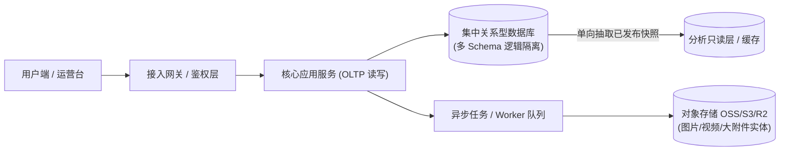

# 技术架构说明书（System Architecture）

> 本文档定义系统的基础设施底座、模块分层、集中数据存储拓扑与富媒体存储方案。写代码前先盘点已有资源，禁止未经论证新建平行数据库或影子入口。

---

## 1. 存量基础设施盘点与复用决策

| 资产类型 | 检查范围（本地 / 既有服务器 / 云服务） | 盘点结果（已有 / 无） | 本项目决策（复用 / 分 Schema 接入 / 独立新建 / 禁止触碰） |
| :--- | :--- | :--- | :--- |
| **关系型数据库（OLTP）** | `<如：既有 PG / MySQL 实例或无>` | `<现状>` | `<如：复用既有 PG 实例，新增 schema_x>` |
| **分析型引擎（OLAP）** | `<如：DuckDB / ClickHouse 或无>` | `<现状>` | `<如：只读抽取汇总，不与事务库争锁>` |
| **对象存储（图片/媒体）** | `<如：OSS / COS / S3 / R2>` | `<现状>` | `<如：新建私有 bucket，按项目前缀隔离>` |
| **认证与通知通道** | `<如：OIDC / SSO / Webhook>` | `<现状>` | `<现状与复用边界>` |

---

## 2. 系统总体分层拓扑

| 层次 / 组件 | 职责边界 | 运行入口 / 端口 | 关键外部依赖上限（超时/配额/并发） |
| :--- | :--- | :--- | :--- |
| **接入与鉴权层** | `<路由转发、TLS、登录态校验>` | `<唯一受管端口>` | `<请求体上限 / 限流阈值>` |
| **核心业务服务** | `<状态机流转、权限校验、事务落库>` | `<启动命令>` | `<查询 p95 延迟 / 内存上限>` |
| **异步 Worker** | `<定时采集、文件解析、重试退避>` | `<队列入口>` | `<单任务超时 / 并发路数 / 计费熔断>` |

---

## 3. 数据集中存储架构（Single DB · Multi-Schema）

1. **物理集中原则**：同一信任域与业务闭环共用一套集中关系型数据库，通过 **Schema / 命名空间** 做逻辑隔离（`core` 共享主数据 + 业务域 Schema），禁止每个新功能另起物理数据库实例。
2. **读写与计算分离**：高频事务写入与状态机统一在事务库（OLTP）完成；大批量报表聚合单向抽取至分析只读层（OLAP）或只读视图，禁止分析慢查询拖垮在线写入。
3. **人工修正与历史冻结隔离**：人工特批规则独立建表（如 `core.manual_overrides`），严禁被自动化重算任务覆盖；已冻结历史底包保持只读挂载。

---

## 4. 图片与富媒体资产存储方案

> **三条铁律**：① 业务图片与大文件**禁止入 Git**；② **禁止长期堆放应用服务器本地磁盘**；③ **禁止只存第三方 CDN 原始 URL**（防过期 `403` 死链）。

| 设计维度 | 标准规范（按项目实况确认后锁定） |
| :--- | :--- |
| **存储引擎与生命周期** | 物理文件存入私有对象存储（OSS / COS / S3 / R2）；本地磁盘仅作 `/tmp` 临时处理并在上传后立即清理；临时图（如验证码/草稿预览）设自动过期 TTL，正式资产永久保留。 |
| **内容寻址与去重** | 统一按 `media/{sha256前2位}/{sha256}.{ext}` 存盘，相同文件全库物理只存 1 份；数据库只存元数据登记表（`core.media_assets`），不存二进制 BLOB。 |
| **元数据追踪与状态机** | 记录 `media_id`、`sha256`、`object_key`、`source_url`、`ingest_status`（`pending / mirrored / source_expired / failed`）、`width / height / mime_type / bytes` 及可选视觉指纹 `phash`。 |
| **访问控制与外链隔离** | 内部后台/预览一律通过后端鉴权后签发**短时效预签名 URL** + 缩略图参数；需长期对外展示的配图（如邮件插图）独立放置于只读公开前缀 `public-assets/` 并与私有业务图物理隔离。 |
