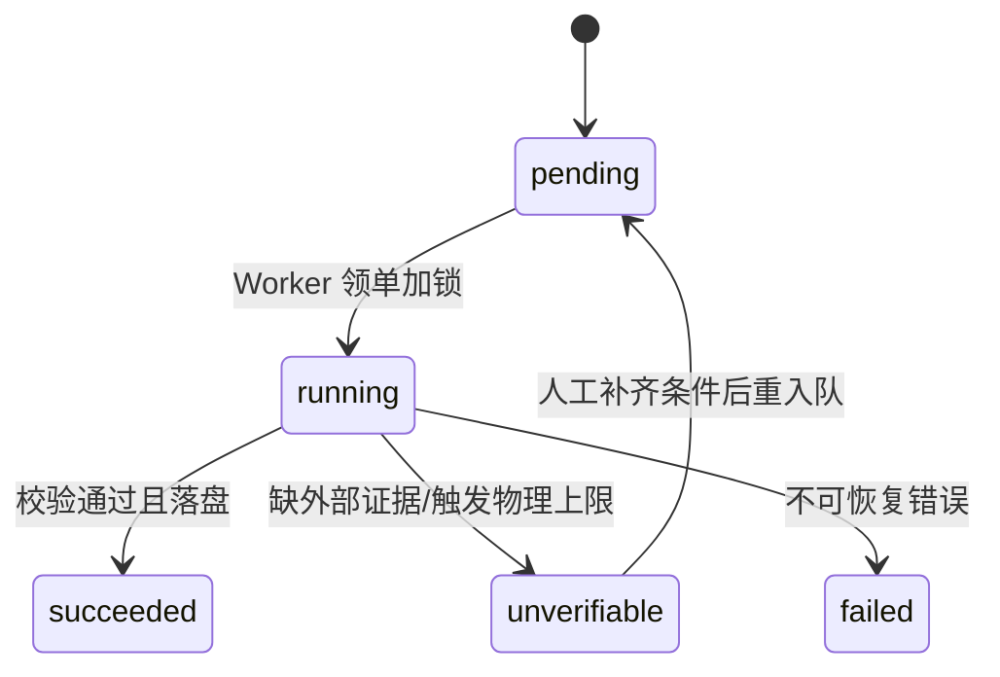

# 业务流程与数据模型契约（Data Model）

> 本文档定义集中数据库 Schema 划分、核心表粒度、唯一幂等键、状态机转换及迁移规范。修改任何结构前先核对本契约，保持与 `SPEC.md` 术语表一词一义。

---

## 1. Schema / 命名空间规划

| Schema 名 | 职责定位 | 允许写入方 | 对外暴露视图 / 契约 |
| :--- | :--- | :--- | :--- |
| `core` | 全局受控字典、主数据、人工特批覆盖表、`media_assets` 元数据、异步任务队列 | 总控服务 / 管理员 | 只读字典与受控外键引用 |
| `<domain_a>` | `<核心业务域 A 的原始输入、主事实表与汇总发布表>` | `<指定模块或 Worker>` | `<仅暴露已发布视图>` |

---

## 2. 核心实体粒度与幂等键设计（防扇出翻倍与重复入库）

| 表名 | 业务粒度（一行代表什么） | 唯一业务主键 / 幂等键 | 重复写入策略（Upsert / 忽略 / 留痕） | 人工层隔离方式 |
| :--- | :--- | :--- | :--- | :--- |
| `core.media_assets` | 一份唯一内容哈希的媒体文件 | `sha256` | 按 `sha256` 幂等复用，不重复上传 | 人工标注存独立字段/关联表 |
| `<domain_a.entity>` | `<例如：一个自然月×唯一商品>` | `<(period_month, item_key)>` | `<冲突时保留有效非空值或最新版本号>` | `<关联 core.manual_overrides>` |

---

## 3. 核心业务流程与状态机

- **合法状态迁移约束**：禁止跳过校验直接置终态；外部未返回明确确认时不得标为 `succeeded`。

---

## 4. 数据库迁移与防冲突规范

1. **线性编号禁止重号**：所有 DDL 迁移脚本按递增序号顺序管理（如 `0001_*.sql`、`0002_*.sql`），禁止并行分支产生同号脚本。
2. **禁止在未对账的线上库直接强推全量同步**：执行迁移前必须先在空隔离库顺序演练全部历史迁移文件，核对表数、列、索引与枚举一致。
3. **跨粒度聚合禁令**：父表金额/数量字段严禁冗余下沉到子明细表直接 `SUM`；所有指标聚合公式必须在 `docs/tracking/FORMULA.md` 登记并绑定 3 组手算样例。
